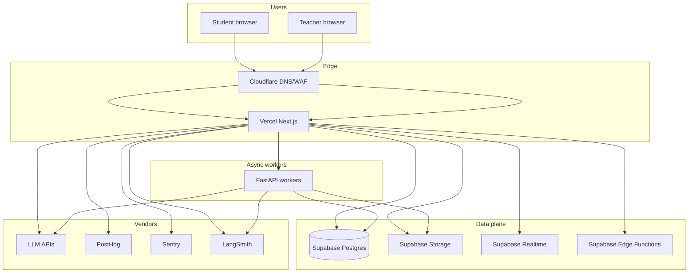

# StudyOS — System Design

**Authority:** implements `FINAL_ARCHITECTURE.md`
**Audience:** staff engineers, security reviewers, SRE

---

## 1. System context (C4 Level 1)

StudyOS is a **student-first web platform** with optional **institute multi-tenancy**. External actors: students, teachers, parents (notifications only), LLM vendors, push notification services, WhatsApp providers, object storage consumers.

**Trust boundaries:**

1. **Browser** — untrusted; may hold BYOK; XSS risk.
2. **Vercel (Next.js)** — trusted app tier; holds platform secrets for server-side AI and webhooks proxy.
3. **Supabase** — trusted data tier; RLS enforced; service role never sent to browser.
4. **Workers (FastAPI async)** — trusted batch tier; service role scoped to job.
5. **Third parties** — semi-trusted; verify webhooks with signatures; timeout all calls.

---

## 2. Container diagram (C4 Level 2)

---

## 3. Major modules (logical)

| Module | Description | Primary owner |
|--------|-------------|---------------|
| **Identity & Access** | Auth, sessions, roles, institute resolution | `apps/web` + `apps/api` |
| **Syllabus** | Versioned exam profiles, chapters, topics, subtopics | `apps/api` + DB |
| **Progress** | Subtopic completions, streaks, study sessions | `apps/api` + DB |
| **Notes Pipeline** | PDF upload, text extraction, vision OCR, mind map parsing, AI structuring, embeddings | `apps/api` |
| **Study Mode** | Full-screen reading, highlights, personal notes, bookmarks | `apps/web` |
| **Notes Search** | Hybrid tsvector + pgvector search across 400+ PDFs | `apps/api` + DB |
| **Notes Download** | Summary PDF, mind map image, highlights export, bulk ZIP | `apps/api` |
| **AI Sessions** | Tutor chat, roadmap, quiz gen, note extraction | `apps/api` + BFF routes |
| **Assessments** | Quiz sessions, PYQ bank, scoring, mistake log | `apps/api` + DB |
| **Analytics** | Progress charts, subject breakdown, heatmap, quiz trends | `apps/web` + `apps/api` |
| **Observability** | Metrics, traces, logs | `apps/web` + `apps/api` |

---

## 4. Request flows

### 4.1 Authenticated page load (student)

1. Middleware reads Supabase session from cookies; refreshes if needed.
2. RSC loads **non-sensitive** dashboard shell; parallel fetch TanStack Query keys for user-specific data.
3. Client hydrates; Query calls **Route Handlers** or **Supabase directly** for RLS-safe reads.

**Rule of thumb:** If the query needs **service role** or **vendor secret**, it goes to **BFF or FastAPI**. If it is **RLS-scoped user read/write**, client may use **anon + user JWT** with hardened policies.

### 4.2 Platform AI chat (streaming)

1. Client opens SSE to `/api/ai/chat/stream` (Next Route Handler, Node runtime).
2. Handler validates session, loads **allowlisted** chapter context from Postgres, pulls **pgvector** chunks server-side.
3. LangGraph run with **platform** API key from env; stream tokens to client; persist assistant message after completion.
4. LangSmith trace IDs stored on `chat_sessions` row for support/debug.

### 4.3 PDF Upload + Processing

1. User drags PDF onto upload dialog → client validates size/type → POST to `/api/notes/upload`.
2. FastAPI validates magic bytes → uploads to Supabase Storage `notes/{user_id}/{note_id}/original.pdf`.
3. Creates `notes` row with status `uploading`.
4. **Processing pipeline** (async, same request for small files, queued for bulk):
   - Detect type: text-based PDF → `pdfplumber`; scanned/mindmap → vision model OCR.
   - Mind map PDF → vision model parses structure → `{ central_concept, nodes[], edges[] }`.
   - AI structurer: tags chapter/topic, extracts key concepts, creates hierarchical summary.
   - Chunks text (200 tokens, 50 overlap) → generates embeddings → stores in `note_embeddings`.
   - Updates `notes` row status to `processed`.
5. Supabase Realtime notifies client → upload queue shows "done".

### 4.4 Bulk Import (400+ PDFs)

1. User uploads ZIP or selects multiple files → POST to `/api/notes/bulk-import`.
2. Creates `bulk_import_jobs` row with status `queued`.
3. Worker processes files sequentially:
   - For each file: run processing pipeline (4.3).
   - Update job progress (`processed_count`, `total_count`, `errors[]`).
   - Supabase Realtime pushes progress to client.
4. On completion: job status `completed` or `partial_failure`.
5. Client shows summary: "387/400 processed, 13 failed".

### 4.5 Global Notes Search (Cmd+K)

1. User opens Cmd+K → types query.
2. Client calls `POST /api/notes/search` with `{ query, chapter_id?, filters }`.
3. FastAPI runs hybrid search:
   - **tsvector** full-text search on `notes.title` + `note_versions.extracted_text`.
   - **pgvector** similarity search on `note_embeddings`.
   - Combine results with hybrid ranking.
4. Returns results grouped by note with matching snippets.
5. Click result → opens note at exact page with highlight.

### 4.6 Study Mode

1. User opens note → clicks "Study Mode" → full-screen view.
2. PDF rendered page-by-page via react-pdf.
3. User highlights text → stored in Dexie (offline) → synced to `highlights` table.
4. User adds personal note on page → stored in Dexie → synced to `personal_notes` table.
5. User bookmarks page → stored in Dexie → synced to `bookmarks` table.
6. All annotations persist across sessions and devices.

### 4.7 Download Notes

1. User opens note → clicks Download → selects format.
2. Options:
   - **Original PDF:** signed Storage URL (1h expiry).
   - **Summary PDF:** FastAPI generates PDF with AI summary + key points + formulas.
   - **Mind Map PNG/SVG:** renders mindmap JSON to image.
   - **Highlights:** exports highlights + personal notes as markdown/PDF.
   - **Bulk ZIP:** merges multiple notes into ZIP.
   - **Chapter Compilation:** merges all notes for a chapter into single PDF.

### 4.8 BYOK chat (optional path)

1. Client holds key in Dexie; calls provider **from browser**.
2. Optional: transcript sync to Supabase **without** storing key.

**Enterprise note:** BYOK client-direct minimizes StudyOS liability; support burden increases.

---

## 5. Offline-first design (minimal viable)

**Offline allowed:** syllabus cache (read-only snapshot), checklist mutations, draft notes, highlights, personal notes, bookmarks, queued sync operations.
**Online required:** first login, AI generation, PDF upload/processing, initial syllabus seed download.

**Sync model:**

- **Outbox table in Dexie** with monotonic `client_mutation_id`.
- On reconnect, BFF `/api/sync/push` validates batches with **version vectors** per row.
- Conflict policy: **server wins** on scalar fields; **last-write-wins** on user-owned notes with merge UI for rare conflicts.

---

## 6. Multi-tenancy (institutes) — FUTURE

1. **Middleware** parses host `slug.studyos.app` → loads `institutes` row by slug.
2. **RLS:** `institute_id` match OR user is platform admin.
3. **Branding:** per-institute theme tokens loaded server-side into CSS variables.

---

## 7. Content security

- **CSP:** default-src 'self'; strict **frame-ancestors**; img-src includes Storage CDN; **connect-src** lists LLM domains if browser-direct BYOK.
- **Sanitization:** server strips dangerous markdown; client second-pass DOMPurify.
- **Uploads:** server-side magic-byte validation before Storage upload; max 50MB per file.
- **PDF processing:** sandboxed; no arbitrary code execution from PDF content.

---

## 8. Rate limiting & abuse

| Surface | Mechanism |
|---------|-----------|
| Public APIs | Upstash sliding window per IP + user |
| AI platform | Per-user daily token budget |
| Auth | Supabase built-in + Cloudflare bot fight mode |
| PDF upload | Per-user daily limit (50 files), max 50MB each |
| Bulk import | 1 concurrent job per user, max 500 files per job |

---

## 9. Failure modes

| Failure | Behavior |
|---------|----------|
| LLM vendor down | Fallback model chain; degrade to cached study plan |
| Supabase brief outage | Read from Dexie where allowed; queue writes |
| PDF processing fails | Retry 3x; mark as `failed`; user can reprocess manually |
| Vision model timeout | Fall back to text-only extraction; notify user |
| Bulk import interrupted | Resume from last processed file (idempotent) |
| Search index degraded | Rebuild pgvector index; fall back to tsvector-only |

---

## 10. Evolution triggers (when to change design)

- **p95 AI latency > 10s sustained** → move more retrieval to prefetch workers.
- **Postgres CPU > 70% sustained** → split analytics to warehouse; add replica.
- **Search latency > 500ms across 400+ notes** → add Meilisearch/Typesense.
- **PDF processing backlog > 100 files** → scale workers horizontally.
- **Edge Function complexity growth** → consolidate orchestration into FastAPI workers.

---

*See also: `API_ARCHITECTURE.md`, `AI_SYSTEM_DESIGN.md`, `DATABASE_SCHEMA_PLAN.md`.*
