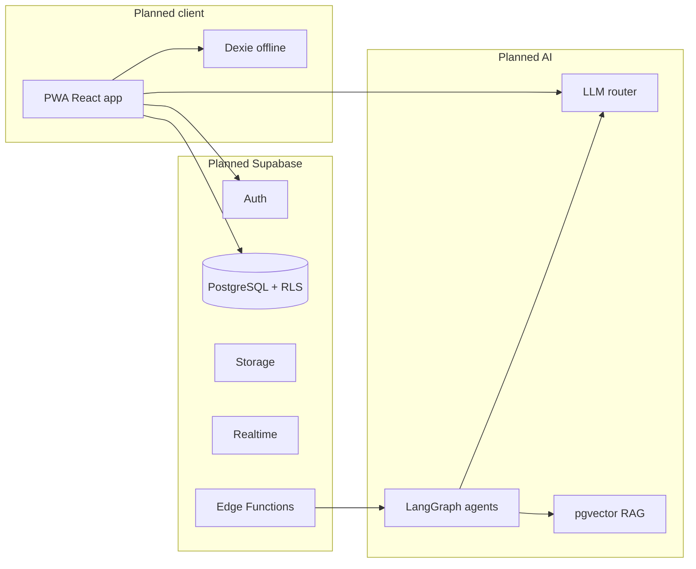

# ?? ARCHIVED ó Historical Document

> **Status:** This document is archived for historical reference only. It may contain outdated information. See FINAL_AUDIT_REPORT.md and DOCUMENTATION_INDEX.md for current state.

---

# StudyOS — Current Architecture

**Scope:** This document describes the **as-documented** architecture from repository materials, and the **as-found** repository layout. It does not assume undeclared code elsewhere.

---

## 1. As-found repository structure (actual)

```
studyos-complete/
└── STUDYOS/
    ├── MASTER_README.md
    ├── plan/
    │   ├── APP_MAP.md
    │   ├── APP_PROMPT.prompt
    │   ├── NEET_2026_Complete_Syllabus_Guide.md
    │   └── ROADMAP.md
    ├── skills-app/          # Markdown guides for Cursor / similar tools
    │   ├── SKILL_AGENTS.md
    │   ├── SKILL_ANALYTICS.md
    │   ├── SKILL_BACKEND.md
    │   ├── SKILL_DESIGN.md
    │   ├── SKILL_FRONTEND.md
    │   ├── SKILL_NEET_DOMAIN.md
    │   └── SKILL_SECURITY.md
    └── skills-claude/       # Binary .skill packages for Claude
        ├── neet-concept-explainer.skill
        ├── neet-result-analyzer.skill
        ├── neet-revision-scheduler.skill
        ├── neet-test-generator.skill
        └── neet-tricks-vault.skill
```

**There is no:** `src/`, `supabase/`, `.github/workflows/`, `package.json`, environment templates, or infrastructure-as-code in this workspace.

---

## 2. Target architecture (from APP_MAP + ROADMAP + MASTER_README)

The documentation defines a **layered** system:

### 2.1 Client application (planned)

- **Framework:** React 18 + TypeScript, **Vite** (canonical in ROADMAP / prompts); occasional “Next.js” mention in MASTER diagram only.  
- **UI:** Tailwind, shadcn/ui, Framer Motion, mobile-first layouts, PWA.  
- **State:** Zustand (global), TanStack Query (server), Dexie (offline).  
- **Pages (planned):** Landing, Auth, Onboarding, Dashboard, Syllabus, Chapter, Notes, Roadmap, Quiz, Analytics, Settings; later teacher/admin shells.

### 2.2 Backend (planned)

- **BaaS:** Supabase — PostgreSQL, Auth, Storage, Realtime, **Edge Functions (Deno)**.  
- **Migrations (planned):** nine groups — auth/users, syllabus, progress, notes, roadmap, quiz, chat, analytics, payments.  
- **Edge functions (named in docs):** roadmap-generator, note-extractor, quiz-generator, whatsapp-scheduler, razorpay-webhook, fcm-push-sender, ncert-indexer, weekly-analytics-rollup.

### 2.3 Data and intelligence (planned)

- **Relational model:** users, institutes, batches, syllabus hierarchy (exam ‚Üí subject ‚Üí chapter ‚Üí topic ‚Üí subtopic), progress, notes (+ versions + embeddings), roadmaps, quizzes, chat, events, subscriptions.  
- **Vector:** pgvector for NCERT chunks, note chunks, optional question embeddings.  
- **Cache:** Upstash Redis (rate limits, hot syllabus, optional LLM response cache).  
- **Analytics warehouse (optional scale path):** Tinybird / ClickHouse; product analytics via PostHog.

### 2.4 AI layer (planned)

- **Orchestration:** LangGraph-style agents; “21st.dev” templates referenced as accelerators.  
- **Agents (named):** tutor, roadmap, note extraction, quiz generator, weak-area detector, motivation; later exam strategy and parent report.  
- **LLM router:** Anthropic, OpenAI, Google, Groq, Ollama with fallbacks and cost hints.

### 2.5 Integrations (planned)

- Google Drive, NotebookLM export (no public API assumed), YouTube Data API, WhatsApp (Twilio / Meta), Razorpay (+ Stripe for intl), FCM push.  
- External **knowledge** sources (483 PW PDFs, Notion, etc.) are described as living outside this repo.

### 2.6 Observability (planned)

- Sentry, LangSmith / similar for LLM traces, Uptime Robot, Vercel Analytics, optional Axiom for Edge logs.

---

## 3. Conceptual data flow (from docs)



---

## 4. “Current” vs “target” one-liner

| Layer | Current (this repo) | Target (documentation) |
|-------|---------------------|-------------------------|
| Code | None | Full stack per APP_MAP |
| Data | Markdown + binary skills | PostgreSQL + Storage + vectors |
| Runtime | N/A | Vercel + Supabase + optional Redis |

---

*Architecture described here is derived from `STUDYOS/plan/APP_MAP.md`, `STUDYOS/plan/ROADMAP.md`, and `STUDYOS/MASTER_README.md`.*
